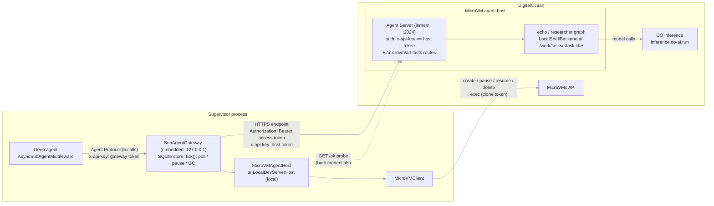
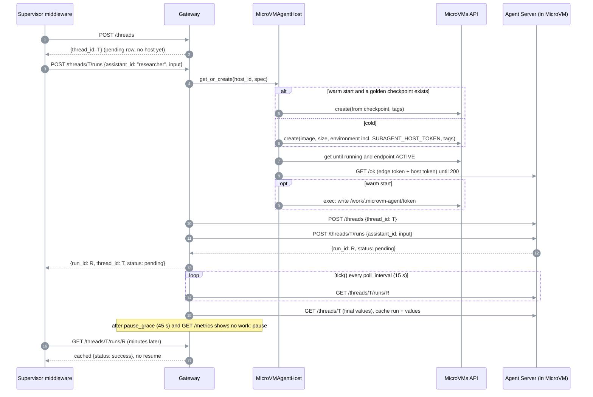
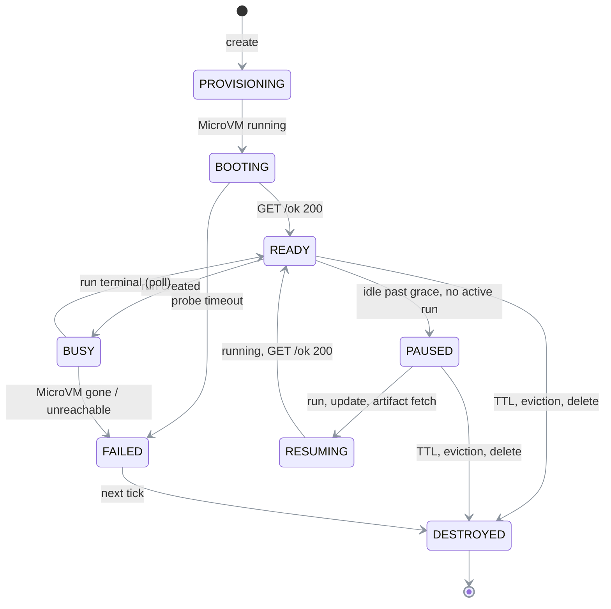
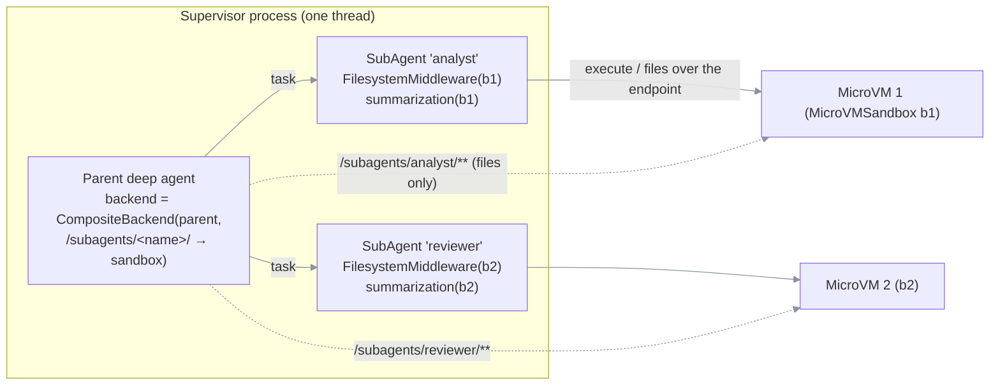

# Design: Deep Agents subagents on DigitalOcean MicroVMs

**Scope:** running LangChain Deep Agents subagents on DigitalOcean MicroVMs, in two ways:

| | Pattern | What runs in the MicroVM | Supervisor tool |
| --- | --- | --- | --- |
| **Agent hosts** (§4) | Agent in sandbox | A whole subagent: an in-memory LangGraph Agent Server serving its graph | `start/check/update/cancel/list_async_task` (`AsyncSubAgent`), through an embedded **gateway** |
| **Subagent sandboxes** (§5) | Sandbox as a tool | Only the subagent's filesystem and shell; its LLM loop stays in the supervisor | `task` (sync `SubAgent`), with its own `MicroVMSandbox` |

Both run on real MicroVMs and in local mode (no credentials). Code: `src/langchain_digitalocean_microvm/` (package), `images/agent-host/` (agent-host image), examples `examples/04_async_subagents/` (agent hosts) and `examples/03_subagent_sandboxes/` (subagent sandboxes).

Tested with `deepagents` 0.7.x (supported range `>=0.7.0,<0.8.0`), `langgraph-api` 0.11-0.16, `langgraph-sdk` 0.4.x and `langgraph_runtime_inmem` 0.31-0.36. `site-packages/` means the virtualenv's `lib/python3.x/site-packages/`.

---

## 1. MicroVM facts this design relies on

The [MicroVMs documentation](https://docs.digitalocean.com/products/microvms/) is the reference for the service's sizes, limits and API ([Limits](https://docs.digitalocean.com/products/microvms/details/limits/), [API and doctl reference](https://docs.digitalocean.com/products/microvms/reference/endpoints-and-commands/)); where it and this section differ, it wins. This section lists only what the design depends on, plus behaviour seen in testing that the documentation does not cover. All DigitalOcean-specific behaviour lives in `client.py`; `scripts/probe_api.py --fixtures` re-records the API responses that `tests/unit_tests/fixtures/microvm_api/` replays.

- **API.** `/v2/microvms`: create (from an image or a checkpoint), get, list (`name`, `tag_name`, `region` filters; paginated), delete (204, then `terminating` for a while), `/pause` and `/resume` (synchronous, idempotent), `/exec`, `/console`, `/checkpoints`, `/options`. **No update endpoint**: image, size, environment, tags, port and idle timeout are fixed at create.
- **Workload.** One `linux/amd64` container image (Docker Hub or DOCR) with its default command and one HTTP port. Environment variables are passed at create and never returned. No SSH, no user-data, no public IP, no firewalls; with public networking (the default) outbound traffic goes through a shared NAT.
- **Endpoint.** `https://<id>.<region>.microvm.ondigitalocean.com`, behind DigitalOcean's edge; every request needs a DigitalOcean token with `microvm:access` (401 without). Endpoint traffic uses an access-only token (§4.8). `x-api-key` and `x-auth-scheme` pass through. A response has to be complete within about 15 s (otherwise the edge answers 504), so longer work runs as jobs that the caller polls. Endpoint requests are not MicroVMs API calls, so they do not use the team's exec budget. A deleted MicroVM's endpoint answers `404`.
- **Pause.** Memory, files and processes survive. **Auto-pause is always on**, after the idle timeout (default and maximum in the MicroVMs documentation; your team's maximum is in `/options`; this package defaults to 10m), and **idle means no inbound requests**: a container busy with CPU and outbound HTTPS is still paused and frozen. Inbound requests every 10 s keep it running. With auto-resume on (the default) the next request resumes it and waits until it is running. The endpoint transport and the agent-host gateway retry a `502`/`503`/`504` about a second later, and `MicroVMClient.pause`/`resume` confirm the requested state with a `GET` (sending the pause again while the MicroVM still reads `running`).
- **Exec.** Runs a single command and returns its output: argv run directly in the container (optional `cwd`), **as the image's user** (no user option, no stdin); 60 s per command, 4 MiB output, 1 MiB request, and **32 commands at once and 60 per minute per team** ([Limits](https://docs.digitalocean.com/products/microvms/details/limits/#command-and-console-limits); the `exec` transport is sized to these numbers), so it is not meant for high-volume work; with auto-resume on it resumes a paused MicroVM. Linux caps one argv element at 128 KiB. This package uses exec to install and re-key the sandbox server, for agent-host administration, and as the optional `exec` transport; sandbox commands and files go through the endpoint (§5).
- **Checkpoints.** Memory + disk. A MicroVM created from one is `running` when the create call returns, with its processes still running, inherits image, size, region and **environment** (an `environment` in the request is rejected), and gets a new hostname.
- **Limits.** Paused MicroVMs count against the team's total. Sizes and regions are in the [MicroVMs documentation](https://docs.digitalocean.com/products/microvms/details/limits/) (not every size is available on every plan); this package and its examples use `1vcpu-2gb` in `mkc1`. The team's limits and available sizes are listed by `GET /v2/microvms/options`. Names: 1-63 chars of `[a-z0-9-]`, unique per team and region. Tags may contain `:`.
- **Timing.** Typical times of create, clone, pause, resume and calls are in [Performance](reference.md#performance); a larger image or checkpoint takes longer to start.

---

## 2. Constraints from deepagents and LangGraph

Each of these shaped a decision below.

1. **A dead async-subagent server leaves its task `running` forever.** If `runs.get` raises, `check_async_task` returns an error string and does not update task state, and `list_async_tasks` returns the cached status (`site-packages/deepagents/middleware/async_subagents.py`). Only a response with `{"status": "error"}` marks the task failed. Hence the gateway (§4).
2. **The in-memory Agent Server cannot recover orphaned runs.** `langgraph_runtime_inmem` persists to `./.langgraph_api/` pickles, but a run in flight when the process dies stays `running` (no sweep at start). The gateway records `booted_at` and treats older run rows as errors.
3. **`x-api-key` is reserved and auto-filled.** The SDK refuses it in `AsyncSubAgent.headers` and fills it from `LANGGRAPH_API_KEY` → `LANGSMITH_API_KEY` → `LANGCHAIN_API_KEY` on every request, so a supervisor with tracing on sends its LangSmith key to the subagent server. Set `LANGGRAPH_API_KEY` to the gateway token (`LazyGateway` does when unset).
4. **Studio auth bypass under `langgraph dev`.** With the default `disable_studio_auth: false`, any request carrying `x-auth-scheme: langsmith` (which the async middleware sends) skips custom auth. The host template sets `"disable_studio_auth": true`. Meta routes (`/ok`, `/info`, `/metrics`, `/docs`, `/openapi.json`) are always unauthenticated.
5. **`--n-jobs-per-worker` defaults to 1 under `langgraph dev`**; always pass it (`HostSpec.n_jobs_per_worker`, default 2).
6. **Webhook URL policy.** The Agent Server requires https and denies loopback webhook targets by default, and a rejected webhook fails `runs.create` (422). Real MicroVMs cannot reach an embedded gateway anyway, so webhooks are off by default and the gateway polls.
7. **Subagent middleware binding.** deepagents builds every sync subagent's `FilesystemMiddleware`, summarization and `SkillsMiddleware` on the **parent's** backend (deepagents 0.7), and replaces a base middleware in place when a spec's own middleware has the same `.name` (`_apply_custom_middleware`). And it **refuses filesystem permission rules on a backend that can `execute`** (`FilesystemMiddleware.__init__` raises `NotImplementedError`).

---

## 3. Package layout and configuration

```
src/langchain_digitalocean_microvm/
├── client.py             MicroVMClient: the whole DO API (only file with DO specifics); api_calls() request counter
├── config.py             MicroVMConfig.from_env() (DO_MICROVM_*)
├── provider.py           MicroVMLifecycle: get_or_create / pause / resume / delete sandboxes (local branch built in)
├── template_cache.py     TemplateCache: a server's template, built once, rebuilt when its checkpoint is gone
├── reconcile.py          settle_to_running: reuse running, resume paused, wait out transitions, recreate failed
├── backend.py            MicroVMSandbox(BaseSandbox): execute / upload / download through a transport
├── transport/exec.py     ExecTransport: commands and files over /exec (shell wrapper, detach + poll, base64 chunks)
├── transport/endpoint.py EndpointTransport: commands and files over the MicroVM's endpoint to sandbox_server.py
├── sandbox_server.py     the in-VM sandbox server (stdlib only): exec with jobs, chunked files, per-sandbox token
├── transport/local.py     LocalTransport: local directory per sandbox
├── subagents.py          subagent sandboxes: one sandbox per sync subagent (§5)
├── threads.py            ThreadSandboxes: one sandbox per conversation thread, paused after each run
├── integrations/deepagents_code.py   dcode SandboxProvider (entry point "microvm")
└── agent_host/           agent hosts (§4)
    ├── models.py         HostSpec, HostHandle, HostStatus, host tags
    ├── env.py            the host's environment (token, worker count, passthrough)
    ├── host.py           MicroVMAgentHost (real MicroVMs)
    ├── warm.py           warm start: golden checkpoints, clones, the clone's token install
    ├── local.py, _guard.py LocalDevServerHost: one local `langgraph dev` per host
    ├── gateway.py        SubAgentGateway: Agent Protocol routes, upstream calls to hosts (Starlette, embedded uvicorn)
    ├── lifecycle.py      HostLifecycle (the gateway's base class): allocation, claims, pause, TTL GC, eviction, startup reconciliation
    ├── store.py          GatewayStore (SQLite): hosts, threads, sandboxes
    ├── spec.py, supervisor.py   async_subagent_spec, LazyGateway, GatewaySettings, fetch_artifacts_tool
    ├── artifacts.py      list/read a task's outputs over any sandbox (no symlinks followed)
    └── sweeper.py        plan/apply GC outside a running gateway (scripts/gc_microvms.py)
scripts/            probe_api, smoke_{exec,agent_host,lifecycle,subagents}, gc_microvms,
                    delete_all, build_sandbox_image, _env (shared settings loading)
images/agent-host/  agent-host image: agent.py (echo, researcher), auth.py, langgraph.json,
                    build_image.py (uv + crane, no Docker), Dockerfile (same image)
```

**Configuration** (the repository's `.env` for scripts and examples; variables set in the shell win over the file):

| Variable | Used by | Meaning |
| --- | --- | --- |
| `DO_MICROVM_API_TOKEN` | all | Control token: `microvm:create/read/update/delete` (update covers pause, resume, exec) |
| `DO_MICROVM_ACCESS_TOKEN` | agent hosts, `endpoint` transport | Access-only token (`microvm:access`) for endpoint traffic; never the control token |
| `DO_MICROVM_TRANSPORT` | sandboxes | `endpoint` (default: the sandbox server over the MicroVM's endpoint), `exec` (the exec API) or `local` |
| `DO_MICROVM_IMAGE`, `DO_MICROVM_HTTP_PORT` | sandboxes | Sandbox image (port default 8080); for agents its user must write to `/` (§5.2) |
| `DO_MICROVM_SIZE`, `DO_MICROVM_REGION`, `DO_MICROVM_IDLE_TIMEOUT` | all | `1vcpu-2gb`, `mkc1`, `10m` by default |
| `DO_MICROVM_MAX_CONCURRENT_CREATES` | sandboxes | Bound on get-or-creates in flight in one `MicroVMLifecycle` (per process); unset: none |
| `DO_MICROVM_NAMESPACE` | all | Owner or deployment on a shared team (§6, Appendix B); unset: the default namespace |
| `DO_MICROVM_HOST_MODE` | agent hosts | `local` (default: local `langgraph dev`) or `microvm` |
| `DO_MICROVM_AGENT_IMAGE`, `DO_MICROVM_AGENT_SIZE`, `DO_MICROVM_AGENT_PORT` | agent hosts | Agent-host image, size (`1vcpu-2gb`), port (2024) |
| `DO_MICROVM_GATEWAY_TOKEN` | agent hosts | Supervisor → gateway token (random per process when unset) |
| `DO_MICROVM_WARM_START` | agent hosts | `1`: new hosts are clones of a golden checkpoint (§4.9) |
| `DO_MICROVM_SUBAGENT_ENV_PASSTHROUGH` | agent hosts | Supervisor variables copied into each host's environment (none by default) |
| `DO_MICROVM_SUBAGENT_TEMPLATE` | agent hosts, local mode | Template directory `LocalDevServerHost` serves (default: `images/agent-host/` in a source checkout, else the copy packaged in `agent_host/_template/`) |
| `DO_REGISTRY_TOKEN` | image builds | DOCR push (`registry:read` + `registry:update`) |

**Conventions.** `config.py` is the one module that reads `DO_MICROVM_*` environment variables (a test enforces it; `env_value`, `env_flag`, `env_int` and `env_csv` serve the settings that live elsewhere, such as `GatewaySettings`); frozen dataclasses; sync API with `asyncio.to_thread` twins (the client is sync; async callers never block the loop); injected clocks, clients and transports for tests; local mode for everything above `client.py`. MicroVMs are found by a **deterministic name** (`microvm_name(prefix, id)`, hashed when the id is not a valid name), not by tags. Every MicroVM this package creates carries `microvm-sandbox`; the other tags are in Appendix B.

---

## 4. Agent hosts: subagents behind a gateway

**Where this sits in LangChain's sandbox patterns.** LangChain describes two ways to connect an agent to a sandbox ([Sandboxes for Deep Agents](https://docs.langchain.com/oss/python/deepagents/sandboxes)): *sandbox as tool* (the agent runs on your server and calls `execute` and file operations remotely) and *agent in sandbox* (the agent runs inside the sandbox and is reached over HTTP or WebSocket). Subagent sandboxes (§5) are the first; agent hosts are the second. LangChain recommends sandbox as tool for most uses, because credentials stay outside the sandbox and agent code updates need no image rebuild; agent in sandbox fits an agent tightly coupled to its environment, or one whose production setup should mirror local development.

Agent hosts follow the pattern's recommended shape: the communication layer, which some providers ship in their SDK and others leave to you, is the gateway (§4.1), and each task gets its own sandbox with a TTL, as in LangChain's thread-scoped default (§4.5).

They diverge from LangChain's guidance in one place: the host holds secrets (the host token and a model key, §4.8) because the workload makes its own outbound requests and so holds the credentials it needs. Prefer subagent sandboxes (§5) when the subagent does not need to run inside its environment.

### 4.1 Architecture



- **Supervisor**: any deep agent with `subagents=[AsyncSubAgent(url=<gateway>)]`. It knows nothing about MicroVMs.
- **Gateway** (`SubAgentGateway`): an Agent Protocol proxy that owns addressing and lifecycle. It allocates a host per task (or per graph when pooled), forwards the calls the middleware makes, caches finished runs so `check` never wakes a paused host, pauses idle hosts, deletes expired ones, and turns a dead host into `status: error` (constraint 1). Embedded in the supervisor process (uvicorn thread on a loopback port).
- **Host manager**: `MicroVMAgentHost` creates the MicroVM from the agent image with its whole environment (including a fresh random `SUBAGENT_HOST_TOKEN`), settles it to `running`, waits for the endpoint to be `ACTIVE`, then probes `GET /ok` with both credentials. `LocalDevServerHost` has the same surface for local mode.
- **Host**: the in-memory Agent Server (`langgraph dev`) with the template's graphs. The VM is the sandbox, so `researcher` uses a plain `LocalShellBackend`.
- **Supervisor wiring** (`agent_host/supervisor.py`): `LazyGateway(graphs, ...)` bundles a host manager and a gateway. Its URL is known at import (the loopback port is reserved up front), so `gateway.subagent(name=..., description=...)` builds `AsyncSubAgent` specs eagerly, but the gateway and hosts start on the agent's **first turn** (`gateway.middleware()`), because `langgraph dev` re-imports the graph module on every reload. `GatewaySettings.from_env()` reads `DO_MICROVM_HOST_MODE` and `DO_MICROVM_GATEWAY_TOKEN`; starting exports the token as `LANGGRAPH_API_KEY` when unset (constraint 3). `close()` (also `atexit`) destroys local hosts and records them; in `microvm` mode it only stops the gateway. The embedded server thread opts out of `langgraph dev`'s blocking-call detector, which flags the store's synchronous SQLite calls.

**Why a gateway and not `AsyncSubAgent.url` pointing at MicroVMs**: the middleware takes one fixed URL per spec and cannot report a vanished server (constraint 1); MicroVMs are paused most of the time and die. Only a proxy can answer `check` from a cache without resuming, and answer `status: error` for a host that is gone. A per-thread graph factory resolving MicroVM URLs was rejected for that reason; a long-lived shared host per type is available as a policy (`HostSpec(reuse="pooled")`) for trusted subagents.

**Why the in-memory Agent Server**: exact protocol compatibility (runs, `multitask_strategy="interrupt"`, cancel, status literals, `values.messages`), no external services, no license key. A per-task host is disposable, so its dev-grade persistence is enough (constraint 2).

### 4.2 Addressing

`threads.create()` arrives before the gateway knows the graph (`assistant_id` only appears on `runs.create`). The gateway mints the thread id and records a pending row. On the first `POST /threads/{tid}/runs` it resolves `assistant_id` → `HostSpec`, acquires a host, creates the thread **on the host with the same id**, and forwards the run. The supervisor's task id therefore equals the host's thread id end to end, which is also how per-task directories are keyed (§4.7).

### 4.3 Calls

| Supervisor tool | Gateway behaviour |
| --- | --- |
| `start_async_task` | `POST /threads` answered locally; `POST /threads/{tid}/runs` allocates or resumes a host and forwards |
| `check_async_task` | `GET /threads/{tid}/runs/{rid}` and `GET /threads/{tid}` from the cache once terminal; otherwise proxied. Host gone or unreachable `unreachable_threshold` (3) times in a row → `{"status": "error", "error": "…"}`. Run older than the host's `booted_at` → error. A run superseded by a newer one on the thread → `interrupted`; `GET /threads/{tid}/runs` lists the latest run (below) |
| `update_async_task` | `POST /threads/{tid}/runs` with `multitask_strategy="interrupt"`, resuming a paused host; refused (503) if the host was deleted |
| `cancel_async_task` | Proxied while the run is active; answered locally for terminal runs (the server answers 404, which the middleware would report as a failed cancel) |
| `list_async_tasks` | Same as check, per task |

**A task that waits for a human.** A run that hits `interrupt()` (an Action Gateway approval in the subagent's graph) ends `success`; only its thread says `interrupted`. The gateway caches that thread's status and interrupts with its values (the store's `cached_thread`), so the middleware reports the task as `waiting` without waking the host. Whoever answers resumes the task's thread through the gateway (`POST /threads/{tid}/runs` with `command`), which then tracks that run. `GET /threads/{tid}/runs` lists it (the gateway tracks the latest run only, with an optional `?status=` filter), which is how the middleware follows a run another client started. The `waiting` status needs deepagents 0.7.29 or later and following the resumed run 0.7.30 or later; earlier releases report such a task as finished. The supervisor is not woken by the answer: a subagent on another server cannot wake its parent, so the application does.

Every upstream call carries `hosts.edge_headers()` (the access token for DigitalOcean's edge) and the host's token in `x-api-key`. A host answering 401/403, or 404 for a run while the inventory no longer lists it (a deleted MicroVM's endpoint answers 404), counts as unreachable; the inventory decides whether it is gone.

### 4.4 Launch and completion



### 4.5 Host lifecycle and policies



| Policy | Rule | Why |
| --- | --- | --- |
| **Never pause BUSY** | Pause only with no non-terminal run and `GET /metrics?format=json` showing an empty queue; an unreadable `/metrics` counts as busy | A paused VM freezes in-flight sockets to the model endpoint; on resume timeouts fire at once |
| Pause grace | 45 s after the last run ended (`pause_grace`); idle backstop 300 s | Absorbs an immediate check → update without a resume |
| Polling vs auto-pause | The gateway refuses a `poll_interval` above a third of the hosts' idle timeout | Idle = no inbound requests (§1): polling is what keeps a busy host awake |
| Reuse | `per-task` (default): one host per task. `pooled`: one host per graph, tasks as separate threads with separate directories (trusted subagents only). The async example uses `pooled` in `microvm` mode to keep the example's fleet at two MicroVMs | Isolation vs cost |
| TTL | `tick()` deletes FAILED hosts on the next tick, and READY/PAUSED hosts with no active run unused for `release_after` (per-task, 1 h) or `paused_ttl` (any host, 24 h); any use restarts the clock. Decided under the host's lock, re-checked in the store (`begin_retire_host`) | Paused MicroVMs count against the limit |
| Eviction at the limit | On `HostCapacityError` the gateway deletes the least recently active idle host whose results are cached, but only once it has been unused for `eviction_grace` (60 s); otherwise the launch fails with "try again in about N s" | Team MicroVM limit (paused ones count) |
| Retired hosts | The row stays `destroyed` with `retired_reason` (`ttl`, `evicted`, `failed`, `gc`, `deleted`, `vanished`, `closed`): `check` is still answered from the cache, an update is refused (503), an artifact fetch answers 410 with the reason | Precise errors instead of hangs |
| Restarts | On start the gateway hands stored host tokens back to the host manager (`remember_token`) and marks hosts that vanished since the last session destroyed. MicroVM environments are immutable, so a host whose token this process does not know is replaced, not re-keyed | Recovery from the SQLite store alone |
| Outside a gateway | `scripts/gc_microvms.py` (`agent_host/sweeper.py`; dry run unless `--yes`; cron-able) deletes hosts the store marks destroyed/failed or unused past `--ttl`, hosts no row describes past `--orphan-ttl`, interrupted golden builds, failed or old golden checkpoints, subagent sandboxes past `--sandbox-ttl`, and marks rows whose MicroVM is gone. Activity lives in the store because tags are immutable and the API has no last-activity field. Before each delete it re-checks its decision and marks the row `retiring` in one `BEGIN IMMEDIATE` transaction (`begin_retire_host` / `begin_retire_sandbox`); the gateway and subagent provisioning claim a row (`claim_host` / `claim_sandbox`) before resuming or launching, so whichever comes first wins. A host or sandbox used since the plan is kept and reported; a launch that finds its row `retiring` waits for the deletion (`retire_wait`, 60 s; then finishes it itself) and starts a fresh one, and a task update on it is refused | A gateway only collects while its supervisor runs |

**Warm pool: not implemented.** Paused MicroVMs count against the team's total, so a pre-created host takes a slot a real task needs, and warm start already shortens a host's start to a clone's. With a generous limit: N paused clones per graph under ids like `warm-<graph>-<n>`, claimed through a thread → host indirection (a MicroVM's name and tags cannot change), evicted first.

### 4.6 Runtime in the MicroVM (`images/agent-host/`)

- **Graphs** (`langgraph.json`): `echo` (model-free; `sleep N:` delays the answer, `save NAME:` writes `outputs/NAME`) and `researcher` (`make_graph(config)`: a deep agent on `LocalShellBackend` rooted at the task's directory; model `SUBAGENT_MODEL`, default `anthropic-claude-haiku-4.5` on `inference.do-ai.run` with `DO_MODEL_ACCESS_KEY`). `"auth": {"path": "./auth.py:auth", "disable_studio_auth": true}` (constraint 4); `"http": {"app": "./artifacts_app.py:app", "enable_custom_route_auth": true}` adds the artifact routes (§4.7).
- **Auth** (`auth.py`): every Agent Protocol request must carry the host token in `x-api-key` (constant-time compare). The token is `SUBAGENT_HOST_TOKEN` unless the token file `/work/.microvm-agent/token` exists, which wins (clones, §4.9).
- **Environment** (set at create, `agent_host/env.py`): passthrough variables, then `HostSpec.env`, then `SUBAGENT_HOST_TOKEN` and `N_JOBS_PER_WORKER` (always last). Plus the image's `HOME=/work`, `SUBAGENT_WORKDIR=/work`, `PORT=2024`.
- **Image** (`build_image.py`, uv + crane, no Docker): locked dependencies as linux/amd64 wheels plus the four source files in one layer on `python:3.12-slim`, user 1000, entrypoint `python -m langgraph_cli dev --host 0.0.0.0 --port $PORT --no-browser --no-reload --allow-blocking --n-jobs-per-worker $N_JOBS_PER_WORKER`. Tag = content hash. `Dockerfile` builds the same image.
- **Local mode** (`LocalDevServerHost`): one `langgraph dev` per host on a free loopback port, own working directory, generated `langgraph.json`, `./.env`; pause = `SIGSTOP`, resume = `SIGCONT`. Each server runs under `_guard.py`, which terminates it when the spawning process disappears: a `langgraph dev` reload worker dies by a re-raised SIGTERM and never runs `atexit`.

### 4.7 Results and artifacts

- **Result**: `check_async_task` reads the final AI message. The template asks subagents to end with a summary and the files they produced.
- **Per-task directories**: `$SUBAGENT_WORKDIR/tasks/<task id>/`, files to fetch under `outputs/`. The template keys the directory by the run's thread id (= task id, §4.2), so tasks sharing a pooled host never see each other's files.
- **Routes**: `GET /artifacts/{tid}` lists a task's regular files (max 200) and `GET /artifacts/{tid}/files/{path}` returns one (max 10 MiB). The gateway reads them from the host's own Agent Server, which serves `GET /microvm/artifacts/{tid}` and `/microvm/artifacts/{tid}/files/{path}` (`images/agent-host/artifacts_app.py`) on the host's endpoint, with the edge credential and the host token like every Agent Protocol call (`auth.py` checks the token, the app checks it again). Files come in `Range` pages of 4 MiB; a page that does not arrive within the endpoint's ~15 s is asked for again at half the size, down to 512 KiB. A paused host is resumed and left to `tick()` to pause again. **410** when the files are gone: the host was deleted, evicted, or replaced since the task ran (`threads.host_microvm_id`), or it no longer answers and the inventory does not list it. **502** when a live host answers without the routes' marker header (an image built before them: rebuild it).
- **Untrusted contents**: the routes never follow symlinks. Every path component below `SUBAGENT_WORKDIR` (`tasks`, the task id, `outputs`, then each directory of the requested path) is opened with `O_NOFOLLOW` relative to its parent's descriptor, so a component swapped for a symlink fails the open instead of being followed; the file itself is opened with `O_NOFOLLOW | O_NONBLOCK` and must be a regular file (`fstat`); a listing skips non-regular files and never descends into a symlinked directory.
- **Supervisor tool**: `fetch_subagent_artifacts(task_id, paths=None)` (`LazyGateway.artifacts_tool()` / `fetch_artifacts_tool(...)`) copies files into the supervisor's backend (default `StateBackend`) at `/subagents/<task id>/<path>`, max 8 MiB per call.
- **Retention**: as long as the host lives (§4.5). Large files and retention beyond a host's life would need object storage from inside the VM (not built).

### 4.8 Security

```
supervisor ── x-api-key: gateway token ──► gateway ── Authorization: Bearer <access token> ──► edge ──► host
             (LANGGRAPH_API_KEY; also                  x-api-key: <host token>
              Authorization: Bearer <gateway token>)
```

- **Two DigitalOcean tokens.** Endpoint traffic carries an access-only token, which can reach MicroVM endpoints but not manage MicroVMs; the control token never leaves the supervisor. An access token reaches every MicroVM of the team, so the per-host `x-api-key` stays mandatory.
- **Per-host tokens**: 32 random bytes per host, in the MicroVM's environment (or token file) and the gateway's store only (store file mode 0600). The gateway never forwards supervisor headers.
- **Inside the VM**: only the host token and a subagent-scoped model key. Generated code can read both; use a dedicated, rate-limited DO model access key.
- **Meta routes** are unauthenticated (constraint 4): `/metrics` shows queue sizes to anyone with an access token.

### 4.9 Warm start (`DO_MICROVM_WARM_START=1`)

One golden checkpoint per host configuration (image, graph, environment, size; hashed name `microvm-golden-…`), built on first use: boot a host, probe `/ok`, checkpoint, delete it. New hosts are clones. Because clones inherit the golden environment (token included) and the API rejects an `environment` on clone, the host manager writes each clone's own token to `/work/.microvm-agent/token` via exec, which `auth.py` prefers. It does so once the clone answers `/ok` (which needs no token): an exec sent to a fresh clone before its workload answers slows the clone's start. Any failure falls back to a cold create. A serving host is up in a clone's time instead of a cold boot plus the Agent Server's start; the first host pays for building the checkpoint once.

---

## 5. Subagent sandboxes: one MicroVM per sync subagent

Each sync `SubAgent` keeps its LLM loop in the supervisor's process but gets its own MicroVM for `execute` and files.



### 5.1 `subagents.py`

- `per_subagent_specs(specs, backends=..., default_model=...)`: for each sync spec with a backend, adds a `FilesystemMiddleware` (the spec's `permissions`, else the parent's, as `_permissions`; the model's harness-profile tool descriptions), the summarization middleware and, with `skills`, a `SkillsMiddleware`, all on the subagent's backend. deepagents swaps them in for its defaults by name (constraint 7); the spec's own middleware comes after and wins on a clash. Compiled and async subagents, and specs without a backend (including the default general-purpose subagent), pass through.
- `provision_subagent_sandboxes(lifecycle, specs, thread_id=..., default_model=..., seed_files=None, max_workers=4, store=None)`: get or create `<thread id>-<name>` for every sync spec **in parallel** on a bounded thread pool; `seed_files[name]` only into a sandbox this call created; if one fails, the others are paused again and the first error raised. `pause_subagent_sandboxes` pauses them in parallel and logs failures instead of raising (teardown must not mask the run's outcome).
- `templates={name: SandboxTemplate}`: a created sandbox is cloned from that subagent's template instead of booted from the image; seeds still go on top. A `TemplateCache` in its place is rebuilt once when the clone finds the checkpoint deleted (`404`). `on_demand=True`: no provisioning on enter; each subagent gets an `OnDemandSandbox` (a `BaseSandbox` proxy) that runs the same get-or-create on its first command or file operation, once under concurrent first uses (a lock; `asyncio.to_thread` on async paths), returns a provisioning failure to the agent as a failed command / file error and retries on the next use. It delegates `execute_with_offload` to the real sandbox so capture offload follows the transport. `SubagentSandboxes.started()` lists the sandboxes in use; teardown pauses only those. Rationale and production notes: `docs/reference.md`, "Templates and on-demand sandboxes".
- `per_task={name: PerTask(key, max_sessions=8, max_concurrent=4, when_done="delete")}`: that subagent gets one sandbox per `task` call (or per key) instead of one per thread. Its spec gets a `PerTaskSandbox`, a `BaseSandbox` that resolves the running task's sandbox on every call from a contextvar the parent's `TaskKeyMiddleware` (`sb.middleware`, required) sets around the `task` tool call; the middleware also applies the key (`TaskCall`: tool call id, subagent type, description, args), `max_sessions` (a refusal the model reads), `max_concurrent` (a wait) and a per-key lock, and on return deletes or pauses the sandbox (always pauses after a `GraphInterrupt`, so the replay finds it). Sandbox id `<thread>-<name>-<key>`, started on first use like `on_demand`; tags `microvm-subagent-sandbox` and `microvm-per-task-sandbox`. `sb.started_per_task()` lists the live ones; teardown pauses any still live. Reference: `docs/reference.md`, "Per-task sandboxes".
- `asubagent_sandboxes(...)` / `subagent_sandboxes(...)`: context managers for a per-thread graph factory (`make_graph(config, runtime)`; parameters annotated `RunnableConfig` / `ServerRuntime`): provision on enter (via `asyncio.to_thread`), pause on exit. The Agent Server enters the factory for every run, so every run gets fresh `MicroVMSandbox` instances. Introspection (`runtime.execution_runtime is None`) builds the graph from the plain specs.
- `SubagentSandboxes` (frozen): `thread_id`, `backends`, `sandbox_ids`, rewritten `subagents`, `routes()`, `mount(parent_backend)`: a `CompositeBackend` routing `/subagents/<name>/` to that subagent's sandbox. `execute` on a composite goes only to its default backend, so the bridge is files-only; the parent also writes hand-offs through it (`/subagents/reviewer/inputs/...`).
- Sandboxes carry `microvm-subagent-sandbox`. With `store=GatewayStore(...)` each provision/pause records the sandbox's last use (`sandboxes` table); `gc_microvms.py --sandbox-ttl` (default 24 h) deletes unused ones. A sandbox's files live only in it, so the TTL is also how long a thread's subagent files survive between runs.

### 5.2 Constraints and decisions

- **Permissions.** deepagents refuses permission rules on an executing backend (constraint 7), so a sandboxed subagent that has or inherits rules raises `ValueError` naming it; `permissions: []` opts out. The MicroVM is the boundary.
- **Pinned internals.** Name-based replacement, `_permissions` and the harness-profile lookup are deepagents internals: the supported range is `>=0.7.0,<0.8.0`, with a contract test in `tests/unit_tests/test_subagents.py` that fails if the minor version, the three middleware names or the private hooks change, and one in `tests/unit_tests/test_per_task_subagents.py` for the `task` tool's name and arguments that `TaskKeyMiddleware` reads.
- **Capture offload.** deepagents' `execute` redirects output to `/large_tool_results/<call>` in the sandbox shell. `LocalTransport` cannot contain shell redirects, so `SandboxTransport.supports_capture_offload` is `False` for it and `MicroVMSandbox` turns the offload off there; real MicroVMs keep it.
- **Sandbox image must let its user write to `/`.** The model writes absolute paths of its choosing (`/outputs/summary.md`, `/report.md`), and deepagents offloads to `/large_tool_results/` and `/conversation_history/`. Two options were weighed:
  - *Route deepagents' artifacts root to a writable directory* with `CompositeBackend(default=sandbox, routes={}, artifacts_root=...)`. Verified against 0.7.0: `execute` and `supports_execution` use the composite's default, capture offload still applies (`_resolve_capture` accepts a default `BaseSandbox` when the path falls through unchanged), file tools pass paths unchanged, and both offload prefixes derive from `artifacts_root`. But it only moves deepagents' own paths; the model's paths stay unwritable, and remapping those would make file tools and `execute` disagree.
  - **A root sandbox image (chosen).** `scripts/build_sandbox_image.py` uses crane only, with no added layer: the `python:3.12-slim` linux/amd64 manifest pinned by digest (root, sh, coreutils, python3), entrypoint the sandbox server (`sandbox_server.py`) on 8080, which answers `/healthz` without a token, serves nothing else without the sandbox's own token and logs nothing (the data plane of the `endpoint` transport; the `exec` transport ignores it). The `microvm-subagent` image (uid 1000) cannot be used.
- **Costs.** N subagents = N MicroVMs per thread, and paused ones count against the team's limit. Commands and file operations go to each sandbox's own endpoint (a fraction of a second each), not through the rate-limited API; the API is used for create, pause, resume and delete, plus one exec per new sandbox to give its server its token. With `DO_MICROVM_TRANSPORT=exec` every file operation is at least one exec call instead, and all sandboxes share the team's exec limits (60 per minute, 32 at once); the client backs off on 429.
- `MemoryMiddleware` is not added to subagents automatically; a spec must choose the parent's backend (shared across threads) or its MicroVM (per thread).

### 5.3 dcode provider (`integrations/deepagents_code.py`)

`MicroVMSandboxProvider`, a deepagents-code `SandboxProvider` over `MicroVMLifecycle`, registered as `microvm` (entry point `deepagents_code.sandbox_providers`); only dcode imports it. The lifecycle is built on first use (the registry instantiates providers just to read `metadata`). dcode reports and deletes a sandbox by `backend.id` (the MicroVM id); `MicroVMLifecycle.sandbox_id_for()` maps it back, so both ids work. `get_or_create(sandbox_id=None)` creates `dcode-<12 hex>`; options `seed_files`, `tags`, anything else refused. Errors are re-raised as dcode's `SandboxError` / `SandboxNotFoundError`.

### 5.4 Action Gateway tools (`integrations/action_gateway.py`)

Not a sandbox, and unrelated to the agent-host gateway: a supervisor in the user's process gets
Action Gateway actions through a standalone session (control plane `POST /v2/action-gateway/sessions`,
data plane `actions.do-ai.run` with `X-Session-Id`). The module imports nothing else from this package.

- **Interrupts, not a callback.** `requires_approval` and a connect link both stop the tool with a
  LangGraph `interrupt`; the application resumes the graph. The decision is posted with the caller's
  token, so the approver is the application, never the agent.
- **Resume runs the tool again from the top.** The tool remembers a pending approval per
  (thread, tool, arguments), so the second run does not ask the gateway for another one; the entry
  goes when the interrupt returns. Across a process restart the second run asks again and the first
  approval expires.
- **Search goes through the data plane.** `GET /tools` lists only the gateway's own meta tools;
  `POST /tools/search` (`{"queries": [{"use_case": ...}]}`) returns the session's matching actions
  with their descriptions and input schemas, which also give preloaded tools their schema.
- **Policy as a file** (`ActionPolicy.from_yaml` / `from_mapping`). The three lists of `ActionPolicy` are the schema, so
  nothing is translated and the file reads like the dataclass. What it adds over the Python form:
  - the policy is reviewable data: moving a tool from `ask` to `deny` is a one-line diff a reviewer can read without Python;
  - one copy can serve the code, the README's tier table and every process that builds the same policy, instead of drifting
    apart;
  - a run can point at another file (development, production) without a code change;
  - mistakes are refused when the file is loaded: a tool in two tiers (the session policy would get two rules for it), a
    `do.actions/` prefix or a `default` key (the shape of a session spec, where the default is not always deny), the
    always-allowed meta tools, a list given as a bare string.
  The loader takes a path or a stream and never YAML text, so a mistyped path is an error and not a parse of the path;
  it reads with `yaml.safe_load`. Versions stay in the entries, so the same lists give `tools=`. The file is read when the
  policy is built, so keep it where the agent's tools cannot write. The constructor stays unchanged: it does not run the
  loader's checks.
- **Local mode.** `LocalActionGatewayClient` keeps the gateway's rules in memory: policy, one-shot
  approvals bound to the arguments, expiry, denial and a connect link until `connect()`.

---

## 6. Design decisions

| Decision | Alternatives rejected | Key reason |
| --- | --- | --- |
| A namespace per owner or deployment (tag, name prefix, store file); templates shared | Prefix fixed by the package; one team per user; namespacing templates | A fixed prefix cannot tell two users of the package apart; a team per user is not always available. A namespace is 1-16 lowercase letters or digits (no hyphen) so it can be read back out of a name. The same sandbox id or pooled host id is then a different MicroVM per namespace, and a sweep or `delete_all.py` sees only its own. A template is the same checkpoint for everyone who builds it, so it stays out of the namespace and deleting templates needs `--all-namespaces` |
| Embedded gateway between supervisor and hosts | Per-thread graph factory resolving MicroVM URLs; one shared host per type | Only a proxy turns host death into `status: error` and serves `check` without resuming (§4.1) |
| In-memory Agent Server in the MicroVM | Standalone server (Postgres, Redis, license); custom protocol shim | Exact protocol, zero services; a shim would re-implement the runtime |
| Per-host random tokens; gateway token via `LANGGRAPH_API_KEY`; gateway re-signs; `disable_studio_auth: true` | Forward supervisor headers | `x-api-key` is reserved and auto-filled (constraint 3); Studio bypass (constraint 4) |
| Never pause a BUSY host; pause after a grace | Pause on idle; pause on schedule | Frozen sockets break in-flight runs |
| Artifacts served by the host's Agent Server (custom routes, same token), read in `Range` pages; per-task directories; 410 when the host is gone | Object storage from inside the VM; reading files over the exec API; a second port | No storage credentials in the VM; retention = host lifetime; no control-plane calls per file; a host has one HTTPS port |
| Lazy host allocation keyed by the caller's thread id | Allocate on `threads.create`; rewrite ids | `assistant_id` arrives only with the run; task id = thread id end to end |
| Thread sandboxes (`ThreadSandboxes`): one per thread, paused after each run, claimed and recorded in the gateway store like subagent sandboxes | A documented pattern over `get_or_create` | The pattern leaves out what a long-running server needs: expiry by the sweeper (without a tag and store rows thread sandboxes accumulate until the team limit), the claim against a concurrent sweep, a bound on concurrent creates |
| Subagent sandboxes via per-spec middleware replacement + `CompositeBackend` mounts | Fork deepagents; `SubAgentMiddleware` subclass | Uses deepagents' own replacement hook; parent keeps files-only access |
| The real MicroVMs API: image + environment at create, exec for commands and files, lookup by deterministic name | SSH/systemd bootstrap; tag lookup | No SSH, no user-data, immutable environment; names are unique and exactly filterable |
| Two DO tokens: control for the API, access-only for endpoint traffic; per-host `x-api-key` still required | One token for everything | Least privilege: the token sent with endpoint traffic cannot manage MicroVMs |
| Sandboxes on a root image (`build_sandbox_image.py`) | Route deepagents' `artifacts_root` | The model's own absolute paths must be writable (§5.2) |
| Sandbox commands and files over the endpoint to a server in the VM (`endpoint` transport, default); exec only to install and re-key it | Everything over exec (kept as the `exec` transport) | Exec runs single commands within team-wide limits (60 per minute, 32 at once) shared by every sandbox, each call a new process; endpoint requests have no such budget and are about twice as fast per call |
| Per-sandbox token derived from the control token and the MicroVM id, written over exec when the server rejects it | A random token in the environment at create, stored by the supervisor | The id is known only after create; no stored state; a checkpoint clone gets its own token |

---

## 7. Testing

Run: `uv run pytest` (unit), `uv run pytest -m e2e` (local e2e: real `langgraph dev` processes), `uv run pytest -m slow` (LangChain's standard sandbox suite through the real exec wrapper and through the endpoint transport against a local sandbox server, offline), `uv run pytest -m live` (standard suite on a real MicroVM); markers `slow`, `e2e` and `live` are deselected by default; `uv run pyright` type-checks `src/`. Live checks: `scripts/smoke_*.py` (each refuses to start unless the team has room, and deletes what it creates).

- **Client and transports**: recorded API responses (`tests/unit_tests/fixtures/microvm_api/`); the real exec wrapper against a fake client that enforces the API's limits; the real sandbox server behind a fake edge that cuts slow responses and sends requests again (`tests/unit_tests/test_endpoint_transport.py`), and the endpoint answers recorded through the real edge (`fixtures/microvm_endpoint/`).
- **Gateway and hosts**: the real gateway with the SDK client and hosts behind `httpx.MockTransport`; opt-in e2e with real local `langgraph dev` hosts (runs, interrupt, cancel, pause/resume, auth).
- **Supervisor**: the five async tools through the real deepagents middleware with a scripted model.
- **Subagent sandboxes**: processed specs, a contract test on the deepagents internals, parallel provisioning, failure handling, mounts through a real supervisor.
- Known gaps in the standard sandbox suite are xfailed in `tests/standard_suite_gaps.py`.

---

## 8. Risks

| Risk | Mitigation |
| --- | --- |
| API changes | All DigitalOcean specifics in `client.py`; re-run `probe_api.py --fixtures`; contract tests replay recorded responses |
| The token used for endpoint traffic leaks | Access-only token for endpoints (it cannot manage MicroVMs), per-host token, nothing else secret in the VM (§4.8) |
| Auto-pause freezes busy work (idle = no inbound) | Gateway polls at least 3× per idle timeout; never pauses BUSY |
| Team MicroVM limit (paused ones count) | Eviction with grace, TTL GC, `gc_microvms.py`, pooled hosts; no warm pool |
| API rate limits with many sandboxes | Sandbox traffic goes to the endpoints; the API sees lifecycle calls only (`api_calls()` to measure); backoff on 429 |
| Endpoint limits (response time budget, body size) change | Short requests with jobs, chunked files, idempotent retries; `scripts/probe_endpoint.py` re-measures |
| Sandbox server version drifts from the package (templates, long-lived sandboxes) | Protocol check on connect; installed servers are replaced, an outdated image is reported; exec fallback |
| deepagents internals (subagent sandboxes) | Range `>=0.7.0,<0.8.0` + contract test |
| Orphaned runs after a host restart | `booted_at` check; per-task hosts |
| A gateway, a supervisor with subagent sandboxes and `gc_microvms.py` share one store | Compare-and-set in one SQLite transaction per decision: claim before resume, mark `retiring` before delete; a row being deleted is replaced, never resumed |

---

## Appendix A. Agent Protocol contract required of a host

| Method / path | Relied upon |
| --- | --- |
| `POST /threads` | Body may include `thread_id`; returns `{"thread_id"}` |
| `POST /threads/{tid}/runs` | `{assistant_id, input: {messages} \| command: {resume}, multitask_strategy?}` → `{"run_id", "thread_id", "status": "pending"}`; `interrupt` cancels the thread's current run |
| `GET /threads/{tid}/runs/{rid}` | `{"status": pending\|running\|error\|success\|timeout\|interrupted, "error"?}`; 404 if unknown |
| `GET /threads/{tid}` | `{"values": {"messages": [...]}, "status", "interrupts"}`, final AI message last; `status: interrupted` with its `interrupts` after a run that paused for a human |
| `POST /threads/{tid}/runs/{rid}/cancel` | 2xx while active; 404 once terminal (the gateway answers those locally) |
| `GET /ok`, `GET /metrics?format=json` | Readiness; queue sizes for the idle check (both unauthenticated) |

## Appendix B. Tags and names

| Tag / name | Meaning |
| --- | --- |
| `microvm-sandbox` | Every MicroVM this package creates (`client.MANAGED_TAG`) |
| `microvm-sandbox-id:<sandbox id>` | A sandbox's id (`MicroVMLifecycle`); name `microvm-sandbox-<id>` |
| `microvm-subagent-sandbox` | A subagent sandbox (one subagent of one thread) (swept by `--sandbox-ttl`) |
| `microvm-thread-sandbox` | A thread sandbox (`ThreadSandboxes`; one per thread) (swept by `--sandbox-ttl`) |
| `microvm-per-task-sandbox` | A per-task subagent sandbox (`PerTask`), next to `microvm-subagent-sandbox`; id `<thread>-<subagent>-<key>` |
| `microvm-agenthost`, `microvm-agenthost-id:<host id>`, `microvm-agenthost-graph:<graph>` | An agent host; name `microvm-agenthost-<host id>` |
| `microvm-golden` | A warm-start golden build; checkpoint names `microvm-golden-…` |
| `microvm-ag-<id>` | An Action Gateway session (`integrations/action_gateway.py`); not a MicroVM, never listed by the clean-up scripts |
| `microvm-probe` | `scripts/probe_api.py`; names `probe-…` |
| `microvm-namespace:<ns>` | The namespace (`DO_MICROVM_NAMESPACE`) of a MicroVM; its name prefix gets `-ns-<ns>` (`microvm-sandbox-ns-<ns>-<id>`, `microvm-agenthost-ns-<ns>-<id>`, `microvm-golden-ns-<ns>-…`) and its store is `gateway-<ns>.sqlite`. No tag: the default namespace, with the names above. Sandbox templates (`microvm-template-…`) carry no namespace: they are content-addressed and shared |

## Appendix C. Glossary

- **Agent Protocol**: the HTTP API (threads, runs) of LangGraph Agent Server, used by `langgraph_sdk`.
- **Agent host**: a MicroVM running an Agent Server with a subagent graph (§4).
- **Gateway**: the Agent Protocol proxy that owns host addressing and lifecycle.
- **Sandbox**: a MicroVM used only for a subagent's files and commands, through `MicroVMSandbox` (§5).
- **Local mode**: everything above `client.py` running locally (`DO_MICROVM_TRANSPORT=local`, `DO_MICROVM_HOST_MODE=local`).
